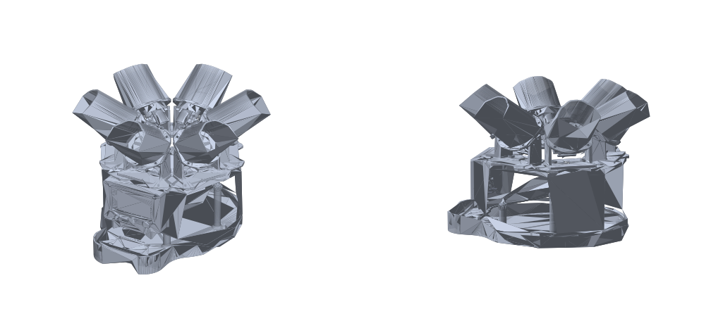
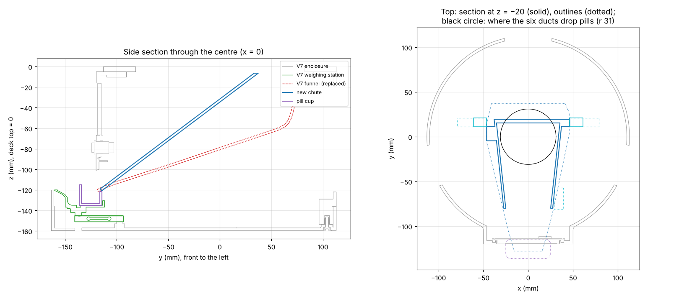

# V2 module for the V7 enclosure

The V2 inclined pocket disc, repackaged so six of them bolt onto the V7 pill dispenser
(`cad/onshape/V7_Pill_Dispenser_Heat_Inserts.step`) in place of its six vertical canister
modules. Each module drops its pills into the V7's central opening. The V7 funnel is
replaced by a printed chute (below), and a removable pill cup sits on the weighing
station; the weighing station itself is unchanged.

## What is kept from V2, and what is new

| | Status |
| --- | --- |
| Disc, pockets, hopper bore, cover, 50° tilt, 25 rpm indexing | Unchanged V2 parts. The iron and small-tablet kits passed 200/200 trials as a stand-alone V2. |
| Exit duct | New: 38 mm long (V2: 96 mm). The exit-relief section continues only 12 mm into it, then the duct narrows to the plain exit-hole section so the six ducts fit where they converge. |
| Drive | New, more compact: two R4-ZZ bearings 18 mm apart, a 1:1 pair of printed spur gears (module 1.5, 14 teeth), and the gearmotor on its own mount behind the gears, below the shaft. |
| Hopper flange and back plate | Trimmed to the module's 60° slice of the deck (1.7 mm³ of the iron hopper is removed; nothing pills touch). |
| Stand | New: a base plate that bolts to the V7 deck exactly where a V7 module does, and two cheeks. |

Because the duct changed, the pill path was re-tested in simulation as variant
`v2_v7_module` (`python -m sim.campaign v2_v7_module --pills iron small --trials 200`):

| Kit | Trials passed | Dispenses | Failures |
| --- | --- | --- | --- |
| iron | 200 / 200 | 600 ok | none |
| small | 200 / 200 | 600 ok | none (after rev 41, below) |

The first small-tablet run had 1 double in 600 dispenses: a tablet wedged tilted in its pocket
at the exit and fell late. The disc's closed-pocket undercut went from 12° to 20° (V2 rev 41,
shared with the stand-alone V2), and both the stand-alone V2 and this module were rerun at
200/200. Results are in `results/v2_v7_module/`; the superseded run is in `results/old_rev40/`.

## Gear backlash

The campaign above drives the disc directly. Variant `v2_v7_module_gear` adds the printed
spur pair as a separate motor inertia coupled to the disc through a dead-band spring:
3° of backlash (worst case for 0.1 mm per gear plus print error), 158 N·m/rad mesh
stiffness, 90 % efficiency. The encoder and controller sit on the motor side, as on the
real module.

| Kit | Trials passed | Dispenses |
| --- | --- | --- |
| iron | 200 / 200 | 600 ok |
| small | 200 / 200 | 600 ok |

Results: `results/v2_v7_module_gear/`.

## From the duct to the scale: chute and pill cup

`python -m sim.v7_drop` drops pills from each module's exit pocket through the V7 parts
(enclosure, funnel or chute, weighing station) with random module, pill size, friction
(0.2–0.6), tilt (up to 20°), spin and exit speed (0–65 mm/s), and passes a trial only if
the pill comes to rest on the weighing station.

| Setup | iron | small |
| --- | --- | --- |
| Original V7 funnel | 177 / 200 (20 stuck in the funnel, 3 escaped) | 178 / 200 (22 stuck) |
| Chute, no cup | 199 / 200 (1 escaped over the tray's back lip) | 200 / 200 |
| Chute + pill cup, 1 pill | **200 / 200** | **200 / 200** |
| Chute + pill cup, 4-pill dose | **200 / 200** | **200 / 200** |

The V7 funnel's walls are too shallow for slow pills from the modules: they stop on them.
The chute replaces it: a 37° floor running from under the six duct ends to a lip over the
front of the weighing tray, with side walls cut back where they would hit the front panel
and enclosure ribs. Without the cup, a pill landing on another one in a dose could hop the
tray's 5 mm back lip; the cup (2 mm walls, sitting inside the tray) holds them. A dose
passes only if every pill rests in the cup or on the station. Results:
`results/v7_drop*/`.

The chute hangs from the V7's three funnel posts on three brackets, using the posts' heat
inserts. The brackets are 8 mm thick at the feet, so the funnel's screws are too short:
use M3 × 16.

To take a dose, the user slides the cup about 6 mm forward, lifts it up and forward
(about 16 mm up over the tray's front ramp, clear of the chute lip), then pulls it out of
the window. A straight lift does not work: the chute lip sits inside the cup. That path
keeps at least 1 mm clear of the enclosure, tray, front panel and chute
(`python sim/v7_cup_removal.py`). Put it back the same way, back wall first. The cup is
about 7 g of PLA, and with 4 iron pills the 100 g load cell sees under 10 g; tare with the
empty cup in place.

## How it mounts on the V7

- **Position**: module centres on a 72 mm radius at 30°, 90°, 150°, 210°, 270°, 330°,
  same as the V7 modules. The hopper leans outward; the drive and exit duct point down
  and inward.
- **Fastening**: two M3 × 6 heat-set inserts (OD 5 mm) in the base plate, at
  (−24, 0) and (+22, 0) mm in the module frame (+y radially outward). These are the V7
  module positions; the V7 deck holes and its M3 × 12 screws from below are reused.
- **Wires**: the slot in the base plate sits over the deck's motor opening; route the
  motor and beam-break cables through it.
- **Pill drop**: the duct ends 27 mm from the enclosure axis (iron) and 54 mm above the
  deck; pills fall clear of every module's drive into the V7 funnel (checked with a
  pill-sized column from the duct end down to the funnel top).

## Checks run

| Check | Result |
| --- | --- |
| `cad/check_printability.py` on every part | Pass: walls ≥ 1.2 mm, no supports. The shaft gear is allowed 12 mm² of overhang for the 0.4 mm ring where its hub meets the tooth roots |
| Overlaps inside one module (`assemble.py --check`) | Only the expected fits: shaft in the disc bore, motor shaft in the motor gear |
| Overlaps with modules 2 and 6 | None |
| Overlaps with the V7 enclosure, funnel, mounts, weighing station, front panel | Only the base plate's two heat-set inserts (expected: they melt into the plastic) |
| Pill path from duct end to funnel | Clear for iron and small tablets |

## Size

Each module stays inside its 72 mm-wide slice at the deck. The hoppers lean outward, so
the top of each overhangs the enclosure edge: the furthest point is 148 mm from the
enclosure axis (the enclosure radius is 113 mm). Tallest point 140 mm above the deck
(V7 modules: 147.5 mm).

## Print

| Part | File | Qty per module | On the bed |
| --- | --- | --- | --- |
| Disc | `<kit>/disc.stl` | 1 | back face down (as saved) |
| Back plate (duct, bearing tube, motor posts, stand tabs) | `<kit>/backplate.stl` | 1 | front face down (as saved) |
| Hopper | `<kit>/hopper.stl` | 1 | flange down (as saved) |
| Cover | `common/cover.stl` | 1 | outer face down |
| Base plate | `common/base.stl` | 1 | flat |
| Cheek, right and left | `common/cheek_right.stl`, `common/cheek_left.stl` | 1 each | flat |
| Shaft gear | `common/shaft_gear.stl` | 1 | gear face down, hub up |
| Motor gear | `common/motor_gear.stl` | 1 | flat |
| Motor mount | `common/motor_mount.stl` | 1 | front wall down |
| Strap | `common/strap.stl` | 1 | rib up |
| Fit-test coupon (once, before everything else) | `fit_test/fit_coupon.stl` | 1 per printer | flat |
| Front spacer, rear spacer | `common/spacer.stl`, `common/rear_spacer.stl` | 1 each | flat |

Once per dispenser (in `chute/`, replacing the V7 funnel):

| Part | File | Qty | On the bed |
| --- | --- | --- | --- |
| Chute | `chute/chute.stl` | 1 | as saved (floor tilted 37°) |
| Pill cup | `chute/pill_cup.stl` | 1 | floor down |
| Brackets, right and left | `chute/bracket_right.stl`, `chute/bracket_left.stl` | 1 each | as saved (on their side) |
| Bracket, front | `chute/bracket_front.stl` | 1 | outer face down (as saved) |

All pass `check_printability.py` with no supports.

Print the back plate in an opaque colour (the beam-break looks through the duct). Other
settings as in `BUILD.md`. `<kit>/module_assembly.step` shows one module put together;
`python cad/variants/v2_v7_module/assemble.py iron` also writes `iron/v7_assembly.step`,
the whole V7 with six modules (50 MB, not committed).

## Buy, per module

| Item | Qty |
| --- | --- |
| 1/4" steel shaft, cut to 40 mm; file a flat 0.6 mm deep on each end | 1 |
| R4-ZZ ball bearing, 1/4" × 5/8" × 0.196" | 2 |
| Pololu micro metal gearmotor with encoder (as in the BOM) | 1 |
| M3 × 6 heat-set inserts, OD 5 mm | 8 (2 base, 4 hopper bosses, 2 motor posts) |
| M3 × 12 socket screws: 2 from under the deck (the V7 ones), 4 hopper to back plate, 2 motor mount to posts, 4 cheeks to back-plate tabs | 12 |
| M3 nuts, cheeks | 4 |
| M3 × 6 set screw and M3 nut, shaft gear | 1 each |
| M2 × 8 self-tapping screws, strap | 2 |
| IR break-beam pair, 3 mm | 1 |

Once per dispenser, for the chute:

| Item | Qty |
| --- | --- |
| M3 × 16 screws, brackets to the V7 funnel posts (replace the funnel screws) | 3 |
| M3 × 6 heat-set inserts, OD 5 mm, in the brackets | 3 |
| M3 × 16 countersunk screws, chute to the left and right brackets (from inside the chute) | 2 |
| M3 × 12 countersunk screw, chute to the front bracket (from inside the chute) | 1 |

## Assembly

0. Print `fit_test/fit_coupon.stl` first, on the printer and filament for the real parts,
   and set the fits from it (see `fit_test.py`): bearing pockets, insert holes, shaft and
   motor bores. Check each printed back plate and hopper carries the kit name (IRON or
   SMALL); the disc's pockets also differ visibly.
1. Press the heat-set inserts: two into the base plate from underneath, four into the
   bosses on the back of the back plate (hopper holes; flush with the boss ends), one into
   the end of each motor post.
2. Press one bearing into the pocket in the front of the back plate, the other into the
   rear end of the bearing tube.
3. Press the disc onto one flatted end of the shaft, shaft end flush with the top of the
   disc's boss. Slide the front spacer on behind the disc and pass the shaft through both
   bearings from the front.
4. Slide the rear spacer onto the shaft behind the rear bearing, then the shaft gear (gear
   face toward the bearing). Hold the disc down, push the gear up to the spacer, and
   tighten its set screw on the shaft's rear flat. The disc must turn freely with no end
   play you can feel.
5. Bolt the hopper to the front of the back plate (4 × M3 × 12, groove over the exit hole);
   glue the cover into the hopper mouth on the high side.
6. Push the motor gear onto the gearmotor shaft (one drop of CA on the flat) until its
   front face is flush with the end of the motor shaft: that leaves the 1 mm gap to the
   mount and lines it up with the shaft gear. Lay the motor
   in the motor mount, gearbox face against the front wall, fit the strap with 2 × M2 × 8
   (its rib presses 0.6 mm into the motor, so it clamps it),
   and screw the mount to the posts with 2 × M3 × 12. The two gears must mesh across their
   full width; turn the disc by hand to check.
7. Bolt the cheeks to the back-plate tabs (4 × M3 × 12 and nuts) and glue them into the
   base-plate slots, square to the base.
8. Fit the beam-break LEDs into the two holes across the duct, 8 mm behind the plate.
9. With the deck off the enclosure (the V7 deck is a separate printed plate), set the module
   on it, wires through the slot, and screw it down from below with the V7's 2 × M3 × 12.
   Fit all six, then lower the deck onto the enclosure.

Once per dispenser, with the deck lifted off and before the modules go on:

1. Take out the V7 funnel. Press an insert into each bracket and screw the brackets to the
   three funnel posts (M3 × 16).
2. The chute's lip goes under the window's top edge and its sides under ribs, so it cannot
   be lowered straight into place. Hold it about 40 mm behind its final position (toward the
   back of the enclosure), lower it straight down to the bottom, then slide it 40 mm forward
   until its ribs meet the brackets. That path is checked with the brackets and front panel
   fitted (`python sim/v7_chute_install.py`); at 30 or 50 mm behind, it hits.
3. Screw the chute to the brackets from inside: M3 × 16 countersunk on the left and right,
   M3 × 12 countersunk at the front (the side ribs are 4.4 mm thicker). The heads sit flush.
4. Set the pill cup on the weighing tray, then put the deck (with its modules) back on.

## Firmware

The gears are 1:1, so encoder counts per disc turn, the 45° index, 25 rpm and timings in
`include/mechanism.h` are unchanged. A spur pair reverses the direction: the disc turns
the opposite way to the motor, and the encoder (on the motor) reads the motor's direction.
Build with `pio run -e dispenser-v7` (flag `MECH_DRIVE_REVERSED`), which inverts the motor
output and the encoder together. Do not swap the motor leads instead: that reverses the
motor but not the encoder, and the firmware stops with ENCODER DIRECTION.

## Not yet proven

- Spur gears printed in PLA at module 1.5: the 21.15 mm centre distance is nominal. The
  simulation passes with 3° of backlash, but check the mesh by hand before powering.
- The motor is held by the strap's 0.6 mm clamp only; there is no hard stop on the gear
  side. Check it does not creep along the mount.
- Tipping: with every hopper full, the dispenser stands on its own (the centre of mass
  stays inside the base). A push of about 2 N sideways at the top of a hopper tips it;
  place it away from table edges.
- The pill cup has 0.5 mm per side in the tray pocket as modelled; a tight print may need
  sanding. Its removal path is checked in CAD only.
- Chute and drop simulations use rigid pills and parts; real PLA surfaces and pill
  coatings may differ.
- Shaft, bearing and gearmotor sizes are nominal; measure them as in `BUILD.md` section 2.
