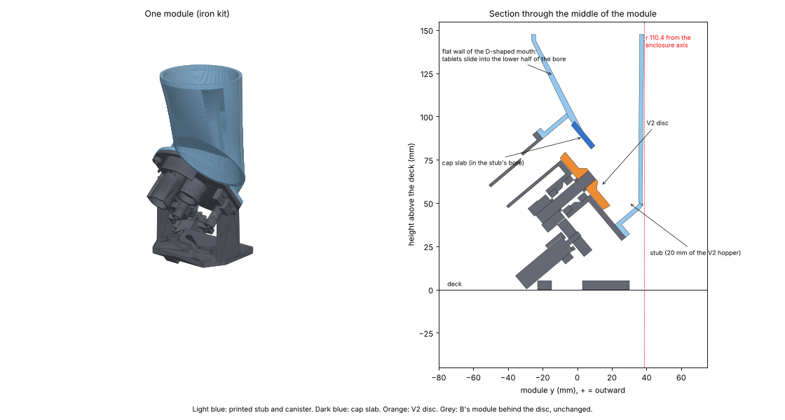

# V2 module with a vertical canister, on the V7 housing

Option D in `docs/shape_options.md`. This is the V7-fit V2 module (`../v2_v7_module`) with
its leaning hopper replaced by an upright canister. The six canisters stand over the V7
body as the V7 canisters do, so the dispenser keeps its round shape. Everything else is the
same as `v2_v7_module`:

- back plate, 38 mm duct, disc, 1/4" shaft, bearings, 1:1 printed gears, gearmotor, stand;
- chute, pill cup and brackets in place of the V7 funnel;
- the V7 deck, shell, lower body, screen panel and weighing station, unchanged.

## What is different from `v2_v7_module`

| `v2_v7_module` | Here |
| --- | --- |
| Hopper: the V2 bore, 70 mm long, leaning 40° outward; furthest point 148 mm from the enclosure axis | **Stub**: the first 20 mm of the same hopper (the bore the disc fills from, 15 mm in front of the disc face, with the exit relief and the bolt flange) |
| Cover: glued into the hopper mouth, closes the upper half | **Canister** (one part): a throat from the stub's tilted opening up to an upright Ø60 mm rim at 147.5 mm above the deck, the V7 canisters' height. Its D-shaped mouth and a 2.4 mm cap slab close the bore's upper half, so there is no cover |

Furthest point 110.4 mm (iron) / 111.0 mm (small) from the enclosure axis. The V7 body is
113 mm.

## Why it is shaped like this

Each feature below fixes something a check found (`python cad/variants/v2_v7_vertical/concept.py`
rebuilds everything):

- **Throat follows the real bore.** The V2 bore is not round: it narrows on the pool side.
  The throat's lower edge is built from the bore's actual outline, because a round edge left
  gaps that tablets fell through in the pour test.
- **D-shaped mouth, no cover.** Tablets poured in must land in the bore's lower half, away
  from the exit at the top of the disc, as in the V2.
  - With the cover moved down to the stub, tablets rested in two places: the crease between
    the cover and the throat, then a level V-groove where the cover's top met the throat
    wall.
  - The fix: the throat's own wall is the straight edge (where the cover's edge was), and
    its solid closes the upper half.
- **Throat up to 144 mm.** A tablet touches no wall flatter than 61° (iron 62.7°, small
  60.9°). At first the throat turned upright at 128 mm. Its inner wall then rose at 51–55°,
  almost along the stub's 50° top face, which left knife edges that could not be printed.
- **Cap slab** (2.4 mm, under the cap, inside the stub's bore with 0.2 mm clearance):
  - makes the cap solid;
  - locates the canister on the stub;
  - has an 8° draft on its curved edge so the canister prints without supports;
  - carries a **key** that drops into the stub's exit-relief groove (0.3 mm clearance), so
    the canister fits one way only and cannot be glued on twisted. It turns less than 3°
    before it binds.
- **Closed-pocket kits** (small tablets) line the bore with a 2.3 mm rib. The canister's
  mouth and cap follow the rib, so its cut end is not left as a shelf.

## Checks

| Check | Result |
| --- | --- |
| `python cad/check_printability.py cad/variants/v2_v7_vertical/<kit>/manifest.json` | Pass, both kits: no supports, walls ≥ 1.2 mm, watertight |
| Canister on stub | No overlap; cap slab 0.2 mm from the bore; key binds before 3° of turn |
| Clash with the V7 deck, shell, lower body, screen panel, weighing station and the neighbouring modules | None |
| 12-seed pour (6–28 tablets, friction 0.2–0.6) | 0 lost, 0 held above the pool |
| Simulation campaign | see below |

## Simulation

PENDING

## Print

Per module, in place of the `v2_v7_module` hopper and cover (all other parts as listed in
`../v2_v7_module/README.md`):

| Part | File | On the bed |
| --- | --- | --- |
| Stub | `<kit>/stub.stl` | flange down (as saved) |
| Canister | `<kit>/canister.stl` | open top of the rim down (turn it over: the file is saved upright) |

Print the canister in a light or clear colour if you want to see the fill level.

## Buy

Same as `v2_v7_module`. The stub uses the hopper's 4 × M3 × 12 screws and inserts. Add
CA glue or epoxy for the canister joint, which replaces the cover's glue.

## Assembly

As `v2_v7_module`, with two changes:

- **Step 5.** Bolt the **stub** to the back plate (4 × M3 × 12; its relief groove goes over
  the exit hole).
- **New last step**, after the module is on the deck and turns freely:
  1. Dry-fit the **canister**: its cap slab drops into the upper half of the stub's bore, with
     the key in the relief groove over the exit. It only goes in one way, and the rim then
     points straight up.
  2. Glue it on.

The canister is glued, so taking it off again means cutting the joint. If the team wants a
removable canister, a screwed joint is the next change (see `docs/shape_options.md`, open
items).
