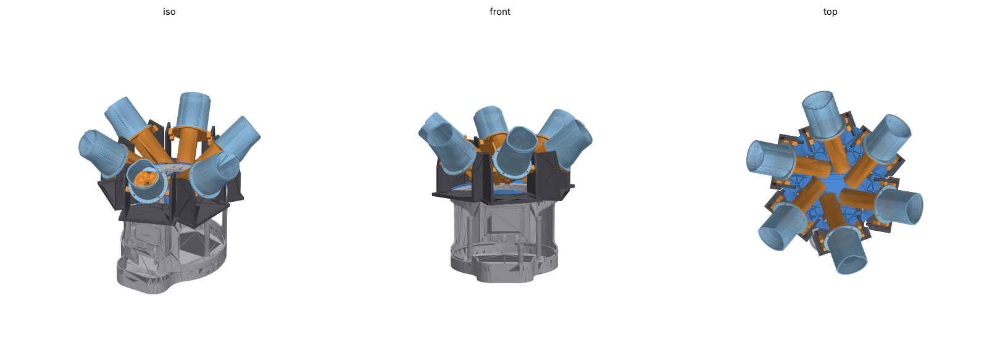
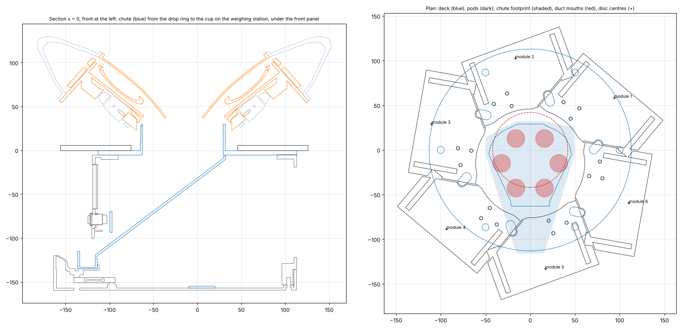

# V8 housing: the V7 enclosure re-done around the V2 modules

An alternate housing for the six-pill dispenser, built around the **unmodified V2 module**
(disc, hopper, back plate with its 96 mm duct, and the original transmission: 1/4" shaft
on two bearings with a flexible coupler to the gearmotor). The V7 Onshape file is not
changed; this folder only adds parts and reuses V7 parts as they are.

## What changed from the V7, and why

The V2 drive line is long: about 100 mm behind the disc, sloping down at 40°. On the V7
deck (modules on a 72 mm radius, pointing at the centre) the six motors would meet at the
middle of the deck. The V7 module variant (`../v2_v7_module`) solved that with a 1:1 gear
pair; this housing solves it by changing the layout instead, so the V2 module is used as
designed and simulated.

| | V7 + geared module | V8 |
| --- | --- | --- |
| Module | V2 disc, 38 mm duct, spur-gear drive | **V2 module unchanged** (coupler drive) |
| Layout | six modules on r 72, pointing at the centre | **pinwheel**: each module's drive 50° off the radial; duct mouths on a 32 mm ring, centred 15 mm in front of the axis |
| Module mount | base plate screwed from under the deck | **pod** screwed from above (3 × M3 × 10): one module comes off without lifting the deck |
| Funnel | V7 funnel (stalls) → replacement chute | chute re-shaped to catch the drop ring: same 37° floor and lip, vertical walls, wholly under the deck; a 30 mm fence round the deck opening |
| Hopper tops from the axis | 148 mm | 204 mm at the front, 172 mm at the back (ring off-centre) |
| Deck, inner shell, lower body, front panel (screen), weighing station | V7 | deck re-made from the V7 deck; **the rest is the V7's, unchanged** |

The layout came from a packing search on the real module solids (iron and small kits
together, so any kit fits any pod): skew angles 0–90° and mouth radii 26–50 mm, keeping
3 mm or more between neighbours and a clear fall from every mouth. Pointing straight at the
centre needs a 35 mm mouth ring and puts the hopper tops 201 mm out; 50° skew with a 32 mm
ring keeps 4.5 mm between modules and brings them to 189 mm.

### The drop: how the chute got to its final shape

The drop simulation (`python -m sim.v8_drop`, 200 tablets per kit, friction 0.2–0.6) found a
problem in each version before the last; each was fixed in the design, never by changing the
test.

| Version | iron | small | What failed | Change for the next version |
| --- | --- | --- | --- | --- |
| 1: chute rising through a round deck opening (`results/v8_drop_rev1/`) | 199 | 200 | a tablet clipped a wall top, landed on the deck and fell through a wire slot | mouth ring 15 mm forward so the chute stays under the deck; vertical walls; deck opening overlaps the walls by 1 mm; 30 mm fence round it |
| 2 | 197 | not run | 2 tablets stopped where a wall turned in at 59° to the flow (that corner slopes only 21°); 1 escape, because the simulated deck had lost its fence (a crop error in the simulation) | walls open out at 25° or less (corner slope 34°, above the 31° friction angle); simulation crop fixed |
| 3 (`results/v8_drop_rev2/`) | 200 | 196 | 3 small tablets caught on a bracket rib standing 5 mm proud of the floor; 1 bounced over the low front walls into the screen-panel bay | inside of the chute cut clean after the ribs |
| 4 (`results/v8_drop_rev3/`) | 200 | 199 | the same bounce into the panel bay | a gate across the chute |
| 5, final (`results/v8_drop/`) | **200** | **200** | — | — |

The gate stands 20 mm before the screen panel and closes the chute above 14 mm from the floor,
up to the wall tops: tablets slide under it (an iron tablet on edge is 9.5 mm) but cannot fly
over the front walls. Two lower gates were tried first: one under the panel touched a panel
part on the way in, and one trimmed to fit under it gave a bouncing tablet a ledge to land on.

## Parts

New (in `parts/`, all print without supports and fit a 256 × 256 mm bed):

| Part | Qty | Size on the bed (mm) | Plastic | On the bed |
| --- | --- | --- | --- | --- |
| Deck: the V7 deck with its module holes filled, the drop opening with a 30 mm fence, inserts for the pods | 1 | 226 × 226 × 35 | 175 cm³ | top face up (as the V7 deck) |
| Pod (one per module; the V2 side plates glue into its slots) | 6 | 138 × 109 × 6 | 45 cm³ each | flat |
| Chute (with the gate) | 1 | 100 × 175 × 70 | 66 cm³ | floor down |
| Brackets, right / left / front (chute to the V7 funnel posts) | 1 each | ≤ 41 × 52 × 10 | 5 cm³ each | flat |
| Pill cup (same as the V7 module version) | 1 | 50 × 22 × 20 | 6 cm³ | floor down |
| Electronics tray, two half-size breadboards (optional) | 1 | 120 × 137 × 7 | 25 cm³ | flat |

Reused unchanged:
- **V7** (`cad/onshape/V7_Pill_Dispenser_Heat_Inserts.step`): inner shell, lower body,
  front panel with the screen and controls, weighing station (load cell), funnel posts and
  the deck-to-shell screws.
- **V2** (`cad/variants/v2_inclined_disc`), per module: disc, back plate, hopper, cover,
  side plates, collar, spacer, clamp, and the bought drive parts (`BUILD.md` there).

The V7 module fasteners and the V7 funnel are not used.

### Buy (on top of six V2 modules and the V7 parts kept)

| Item | Qty |
| --- | --- |
| M3 × 4 heat-set inserts, OD 5 mm (flush in the 5 mm deck) | 18 |
| M3 × 10 socket screws, pods to deck | 18 |
| M3 × 6 heat-set inserts, OD 5 mm (brackets) | 3 |
| M3 × 16 socket screws, brackets to the V7 funnel posts | 3 |
| M3 × 16 countersunk, chute to the side brackets; M3 × 12 countersunk, front bracket | 2 + 1 |

## Assembly order

1. Lower body, weighing station, front panel and inner shell as in the V7.
2. Take out the V7 funnel and its screws. Front bracket on the front post (M3 × 16). Chute in
   from the top: hold it 40 mm behind its place, lower it, slide it forward onto the front
   bracket. Then lower the left and right brackets straight onto their posts (M3 × 16), and
   screw the chute to all three from inside (checked, see below). Pill cup on the tray.
   Optional: tray with the breadboards on the floor.
3. Inserts into the deck (from the top, flush). Deck onto the shell with the V7's screws.
4. Each module: build the V2 module as in the V2 `BUILD.md` (steps for the drive, hopper and
   side plates), glue its side plates into a pod, feed the motor and beam-break wires through
   the pod and deck slot, and screw the pod down (3 × M3 × 10 from above). Any module can be
   unscrewed and lifted off on its own.

The firmware is the V2's (`pio run -e dispenser`): no gear pair, so no reversed drive.

## Checks

| Check | Result |
| --- | --- |
| `check_printability.py parts/manifest.json` | Pass (walls ≥ 1.2 mm, no supports, watertight) |
| `assemble.py iron` / `small`: clashes between every pair of parts (modules, pods, deck, fence, chute, brackets, V7 parts) | None for either kit |
| Pod screws: material round each in pod and deck; a straight driver reaches each from above past all six modules | Pass (checked by ray casting) |
| Chute install path (`python sim/v7_chute_install.py cad/variants/v8_housing/parts --after bracket_left,bracket_right`) | Pass: chute lowered 40 mm back and slid forward; side brackets lowered straight onto their posts after it |
| Pill drop, mouth to weighing station (`python -m sim.v8_drop`), 200 tablets per kit | iron 200/200, small 200/200 (`results/v8_drop/`) |
| Doses of 4 tablets, one after another (`python -m sim.v8_drop --dose 4`), 50 per kit | iron 50/50, small 50/50: every tablet in the cup and touching nothing but the cup and other tablets (`results/v8_drop_dose4/`) |
| Tipping (`tipping.py`, estimated masses, full hoppers: 2.3 kg, centre of mass on the axis 166 mm up) | Tips at 7.8 N pushed sideways at a hopper top, or 31 N pressed down on a hopper's outer rim |

## Not done yet / open

- **Electronics for six modules.** As in the V7 review: the HUZZAH32 has no free pins for
  six motors, encoders and beam-breaks. The floor space is the V7's (the tray shows two
  half-size breadboards fit between the posts); a full-size board fits only diagonally.
- **Home sensing.** No mount yet (as for every V2 build).
- **Size.** The hopper tops reach 204 mm from the axis at the front and 172 mm at the back
  (V7 geared: 148 mm). The pods overhang the deck by up to 43 mm.
- **Glue.** The V2 side plates are glued into the pods, as they were into the V2 base.
- **Cable routing** below the deck and the power jack position are not designed.
