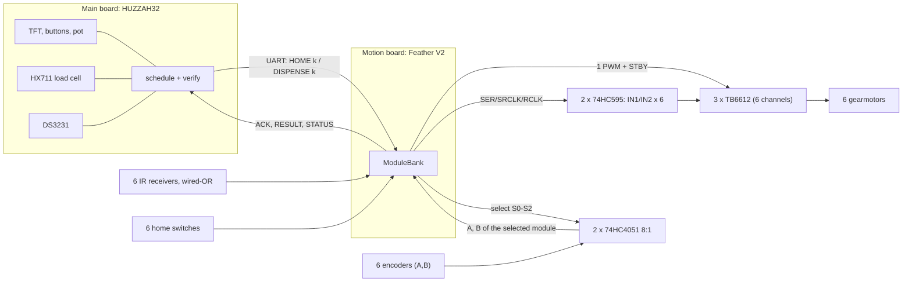

# Electronics for the V8 housing: two boards, six modules

The single-module build uses every header pin of the HUZZAH32 (`include/pins.h`). Six
modules need about 40 more signals, so the work is split over the two boards the team has:

| Board | Job | Firmware |
| --- | --- | --- |
| **Main**: Adafruit HUZZAH32 (#3591) | screen, buttons, pot, load cell, clock, schedule, buzzer, LED; decides *what* to dispense and checks it on the scale | `firmware/dispenser` (to be switched to the link, see "Next step") |
| **Motion**: Adafruit ESP32 Feather V2 (#5400) | the six modules: homing, indexing, beam counting, jam recovery; does *how* | `firmware/motion` (env `motion`), logic in `lib/motion_bank` |

## Why the signals can be shared

Only one module moves at a time: a dose is dispensed pill by pill, and the motion board
refuses a new command while one is running (`BUSY`). So:

- **Motors**: one PWM line goes to all six TB6612 channels. Only the selected module's
  IN1/IN2 are set; every other channel has IN1 = IN2 = LOW, which the TB6612 treats as
  stop (outputs off). Brake is IN1 = IN2 = HIGH on the selected channel only.
- **Encoders**: the selected module's A and B are routed through two 8:1 multiplexers to
  one counter. The gearboxes (1000:1) do not back-drive, so a module that is not selected
  does not move, and the firmware keeps each module's absolute position across switches
  (tested in `test/test_bank`).
- **Beam-breaks**: the six IR receivers are open-collector and share one pull-up, so the
  line goes LOW when any beam is blocked. Only the moving module can drop a pill, so every
  event belongs to it. A pill stuck in another module's duct holds the line low and is
  reported as `BEAM BLOCKED` before the next dispense starts.
- **Home switches**: one input each (there are enough pins).

## Motion board pin map (Feather V2)

Pin numbers are from the board definition in espressif/arduino-esp32
(`variants/adafruit_feather_esp32_v2/pins_arduino.h`); the same table is in
`include/pins_motion.h`.

| GPIO | Silk | Signal | Notes |
| --- | --- | --- | --- |
| 7 | RX | LINK_RX ← main board TX | Serial1, 115200 8N1 |
| 8 | TX | LINK_TX → main board RX | |
| 26 | A0 | MOTOR_PWM → PWMA and PWMB of all three TB6612 | LEDC 20 kHz |
| 13 | 13 | MOTOR_STBY → STBY of all three TB6612 | red LED shows the drivers are on |
| 19 | MO | SR_DATA → 74HC595 #1 SER | |
| 5 | SCK | SR_CLOCK → both 74HC595 SRCLK | |
| 21 | MI | SR_LATCH → both 74HC595 RCLK | |
| 34 | A2 | ENC_A ← "A" 74HC4051 common (Z) | input-only |
| 39 | A3 | ENC_B ← "B" 74HC4051 common (Z) | input-only |
| 25 | A1 | MUX_S0 → both 74HC4051 S0 | |
| 4 | A5 | MUX_S1 → both S1 | |
| 14 | 14 | MUX_S2 → both S2 | |
| 36 | A4 | BEAM ← six receivers wired together | input-only: **external 10k pull-up to 3V** |
| 32, 33, 27, 15, 22, 20 | 32, 33, 27, 15, SDA, SCL | HOME 0–5, switch to GND | internal pull-ups |
| 12 | 12 | spare | strapping pin: leave it unconnected or pulled low |

## Main board (HUZZAH32) changes

Moving the motor, encoder, beam and home signals to the motion board frees eight HUZZAH32
pins: 39, 16, 34, 14, 27, 33, 21, 26. The link uses two of them:

| HUZZAH32 GPIO | Signal |
| --- | --- |
| 27 | LINK_TX → Feather GPIO 7 (RX) |
| 16 | LINK_RX ← Feather GPIO 8 (TX) |

Join the two boards' grounds. Both run at 3.3 V logic, so no level shifting is needed.

## Wiring the support chips

| Part | Qty | Connections |
| --- | --- | --- |
| Adafruit TB6612 breakout | 3 | VM 12 V (after the fuse), VCC 3.3 V, GND; PWMA and PWMB ← GPIO 26; STBY ← GPIO 13; AIN1/AIN2/BIN1/BIN2 ← 74HC595 outputs; A/B outputs to two motors each |
| 74HC595 shift register | 2 | VCC 3.3 V, GND, OE to GND, SRCLR (MR) to 3.3 V; #1 SER ← GPIO 19, #1 QH′ → #2 SER; both SRCLK ← GPIO 5, RCLK ← GPIO 21. Bit 2k = module k IN1, bit 2k+1 = IN2: #1 QA–QH = modules 0–3, #2 QA–QD = modules 4–5 |
| 74HC4051 8:1 analog multiplexer | 2 | VCC 3.3 V, GND and VEE to GND, enable (E) to GND; S0/S1/S2 ← GPIO 25/4/14 (both); "A" chip Y0–Y5 ← encoder A of modules 0–5, Z → GPIO 34; "B" chip Y0–Y5 ← encoder B, Z → GPIO 39 |
| 0.1 µF ceramic | 4 | one across VCC–GND at each 74HC chip |
| 10 kΩ resistor | 1 | beam line (GPIO 36) to 3.3 V |

Each module's harness then carries: motor (2 wires), encoder (VCC, GND, A, B), beam emitter
(2), beam receiver (VCC, GND, signal) and home switch (2): about 12 wires through its pod and
deck slot. The beam receivers' signal wires all join at the motion board.

## Power

- **12 V**: unchanged from `docs/wiring.md`. Only one motor runs at a time, so the peak stays
  one stalled gearmotor (1 A assumed ceiling).
- **3.3 V on the motion board**: the ESP32, six encoders (≈ 5 mA each, assumed in
  `docs/wiring.md`), six IR receivers (≈ 0.5 mA each) and the logic chips (µA). Check the
  Feather V2's 3.3 V regulator rating on its product page. The six IR emitters (≈ 10 mA each)
  can run from the 5 V rail instead, to keep about 60 mA off the 3.3 V regulator.
- **Common ground** for the 12 V supply, both boards, the drivers and the sensors.

## Link protocol

Frames: `0xA5 | len | type | seq | payload | crc8` (CRC-8, polynomial 0x07, over len, type,
seq and the payload); the receiver resynchronises on the next `0xA5` after a bad frame.
Code and tests: `lib/motion_bank/src/boardlink.*`, `test/test_bank`.

| Type | Direction | Payload | Meaning |
| --- | --- | --- | --- |
| `0x01` PING | main → motion | — | answered with STATUS |
| `0x02` HOME | main → motion | module 0–5 | home one module |
| `0x03` DISPENSE | main → motion | module 0–5 | dispense one pill |
| `0x04` ABORT | main → motion | — | stop, back to idle |
| `0x05` CLEAR | main → motion | — | clear a fault |
| `0x81` ACK | motion → main | accepted, reason | sent at once; reason is `BUSY`, `NOT HOMED` or `BAD MODULE` when refused |
| `0x82` RESULT | motion → main | module, outcome, beams, steps, jams | when HOME or DISPENSE finishes; seq is the command's |
| `0x83` STATUS | motion → main | state, module, homed mask, fault | on every state change and on PING |

A dispense indexes up to `MECH_MAX_INDEX_STEPS` (16) pockets. After 8 empty pockets
(`MECH_ROCK_AFTER`) the disc rocks once: back one pitch, return, then index on. In simulation
a lone small tablet once stood on edge against the hopper liner for all 16 pockets (a false
`MISS`, "refill", with a tablet still inside); the rock knocks it flat. A stall during the rock
is a `JAM`; a pill seen during it is counted like any other.

Outcomes: `OK`, `DOUBLE`, `MISS`, `JAM`, `ENCODER DIRECTION`, `HOME NOT FOUND`,
`BEAM BLOCKED`, `HOMING DROP`, `ABORTED`, `HOMED` (codes in `lib/motion_bank/src/bank.h`).
The main board still weighs the cup before and after, as now, and compares the mass
change with the RESULT's beam count.

## Status

| Part | State |
| --- | --- |
| Motion logic (`lib/motion_bank`) | Done. 14 host tests (`pio test -e native -f test_bank`): homing all six independently, one pill, empty pockets, double, miss, refusals, positions kept across switches, jam cleared by a reverse, the rock after 8 empty pockets, permanent jam, reversed encoder, abort, and the link framing. They pass for all four pill types. |
| Motion firmware (`firmware/motion`, env `motion`) | Written; compiled by CI. Not run on hardware. |
| Main-board firmware | **Next step**: replace the direct motor/encoder/beam/home code in `firmware/dispenser` with link commands, add a module choice to each dose in the schedule and menu, and move the pins as above. |
| Home switches and their mounts | Not designed (the V2 module has none). The firmware expects one switch per module, actuated once per disc turn. |
| Per-module pill types | The motion board uses one pill block (`MECH_PILL_*` at build time). Iron and small tablets share every motion value, so a mixed iron/small dispenser works; caplets or capsules beside them would need per-module settings. |
