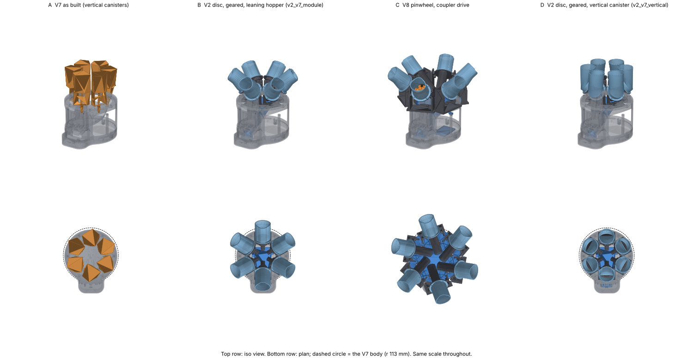
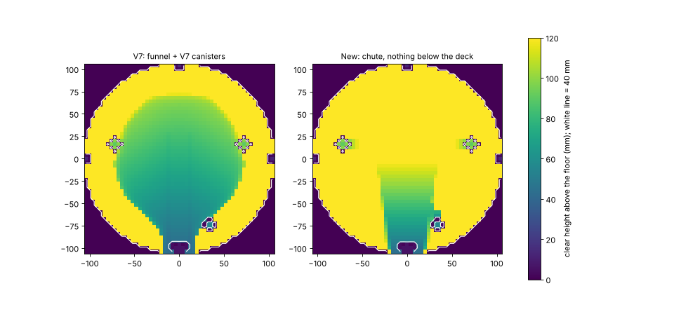
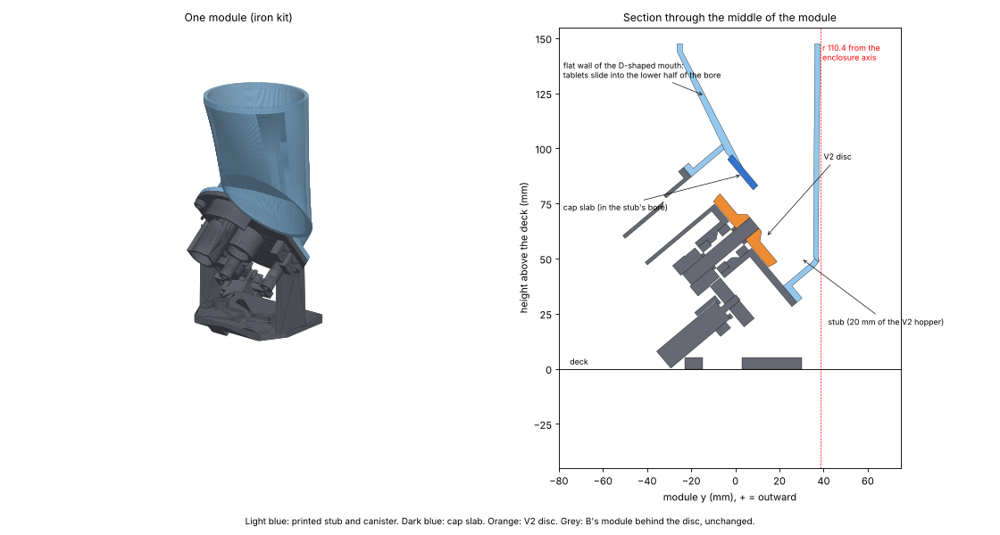

# Shape options for the six-canister dispenser

The team built the V7 housing from Onshape and found three problems:

1. Two breadboards and their wiring are hard to fit inside, because the funnel is in the way.
2. The canister mechanism jams.
3. The V2-module versions on this branch (B and C below) look like a fortress, because the
   canisters lean out past the body.

The question was whether the V2 disc mechanism can start vertical and then angle, so the
dispenser stays round. The constraints:

- Keep the V7 housing, with only the changes that are needed.
- Keep the COTS parts the team already has.
- Change only the canisters and the housing.

Four options, all built from the same COTS parts (gearmotors with encoders, TAL221 load cell
and HX711, TFT screen, buttons, both ESP32 boards, IR beam-breaks):

| | **A**: V7 as built | **B**: V2 module, leaning hopper (`cad/variants/v2_v7_module`) | **C**: V8 pinwheel (`cad/variants/v8_housing`) | **D**: V2 module, vertical canister (`cad/variants/v2_v7_vertical`) |
| --- | --- | --- | --- | --- |
| **Plan view** | round: canisters stay inside the body | canisters lean 40° outward | canisters lean outward, pinwheel | **round**: canisters stand up over the body like A's |
| **Furthest canister point from the axis** | 110 mm | 148 mm | 204 mm | **110.4 mm** (iron), **111.0 mm** (small); the V7 body is 113 mm |
| **Top above the deck** | 147.5 mm | 140 mm | 160 mm | **147.5 mm** |
| **Dispensing mechanism** | V7 canister mechanism (jams, per the team) | V2 inclined pocket disc | V2 inclined pocket disc | V2 inclined pocket disc |
| **Canister capacity** | (V7's) | ≈200 cm³ iron, ≈175 cm³ small (bore up to the cover) | as B | ≈200 cm³ iron, ≈180 cm³ small |
| **Below the deck** | funnel, plus V7 motors hanging 35 mm below the deck | chute + pill cup; nothing else | chute + pill cup; nothing else | chute + pill cup; nothing else (same as B) |
| **Housing changes** | — | funnel → chute, 3 brackets, pill cup | new deck, six pods, new chute | funnel → chute, 3 brackets, pill cup (same as B) |
| **Extra COTS per module** | — | 1/4" shaft, 2 × R4-ZZ bearings | 1/4" shaft, 2 × R4-ZZ, flexible coupler | 1/4" shaft, 2 × R4-ZZ bearings |
| **Printed parts per module** | V7 module | 13 | V2 module + pod | 13 (B's hopper and cover become a stub and a canister) |
| **Pill path simulated** | V7 funnel drop: 177/200 iron, 178/200 small (tablets stall on the funnel) | module 200/200 per kit; with gear backlash 200/200; chute + cup 200/200 | module 200/200; drop 200/200 | **module 200/200 per kit** (with the rock, below); chute + cup as B |

## What each option fixes

### Problem 1: breadboards and wiring (DFA)

Clear height above the enclosure floor, measured by ray casting through the V7 parts, under
the deck:

| | Funnel + V7 canisters (A) | Chute, nothing below the deck (B, D) |
| --- | --- | --- |
| Floor area with ≥ 35 mm clear | 346 cm² | 346 cm² |
| Floor area with ≥ 60 mm clear | 321 cm² | 338 cm² |
| Floor area open from floor to deck (≥ 90 mm) | 213 cm² | **316 cm² (+48 %)** |
| Places a full-size breadboard (171 × 61 mm with margin) fits with 40 mm clear | 141 | 141 |

A full-size breadboard fits in the same places either way. The difference is what is above
it: with the funnel and the V7 motors gone, half again as much of the floor is open all the
way to the deck. That is the room for wires, a hand and a screwdriver when the two boards are
wired to six modules. B and D gain the same space, because D's module is B's below the deck.

C changes the most (new deck and pods), and every module comes off from above without
lifting the deck. But it is the largest shape, and it replaces the most V7 parts.

### Problem 2: jamming

- **A** is the mechanism that jams, and the V7 funnel also stalls tablets in simulation.
- **B, C and D** dispense with the V2 inclined pocket disc. In simulation it passed 200/200
  trials for both kits as a stand-alone V2, as B's module and in C.
- **D** changes only what is above the disc, so its simulation is the check that matters.

### Problem 3: shape

Only A and D keep the round V7 silhouette. D's canisters stand where A's do, about 1 mm
further out (inside the body's 113 mm radius), and reach the same height.

## How D works

D is B's module with the leaning hopper replaced:

- **Stub.** 20 mm of the V2 hopper is kept (the bore the disc fills from, 15 mm in front of
  the disc face, with its exit relief and bolt flange). It bolts to the back plate with the
  same 4 × M3 × 12.
- **Canister.** One printed part.
  - **Throat:** turns from the stub's tilted opening to an upright Ø60 mm canister.
  - **Rim:** the canister's top, at the V7 canisters' height.
  - **Cap:** closes the bore's upper half. This is the V2 cover's job, so there is no
    separate cover.
- **Mouth.** The throat opens into the bore through a D-shaped mouth. Its straight edge is
  where the V2 cover's edge was. Tablets poured in slide down the canister's walls into the
  lower half of the bore and pool against the disc, away from the exit at the top, as in the
  V2.
- **Drive.** Everything behind the disc is unchanged from B: back plate, 38 mm duct,
  bearings, 1:1 printed gears, gearmotor and stand.

Design rules the geometry was iterated against (each was found by a check, then fixed in the
design):

| Rule | Check | Result |
| --- | --- | --- |
| No tablet lost or held above the pool when poured in | 12-seed pour, 6–28 tablets, friction 0.2–0.6 | 0 lost and 0 held, after three fixes: (1) the throat's lower edge follows the V2 bore's real (non-circular) shape, because a round edge left gaps; (2) the D-shaped mouth, because tablets rested in the crease between the cover and the throat wall; (3) the throat itself caps the bore, because the cover's top face and the throat wall made a level V-groove |
| Every wall a tablet touches at ≥ 45° | slope of every face of the throat opening | ≥ 62.7° iron, ≥ 60.9° small |
| Inside the V7 body | furthest point from the enclosure axis | 110.4 / 111.0 mm (2 mm margin) |
| No clash with the V7 deck, shell, lower body, screen panel, weighing station or neighbouring modules | exact mesh intersection | none |
| Prints without supports, walls ≥ 1.2 mm | `cad/check_printability.py` | pass, both kits (canister printed open end down) |
| Canister fits on the stub, one way only | intersection, gap, turned copies | no overlap; cap slab 0.2 mm inside the bore; a key in the exit-relief groove stops it turning (binds before 3°) |

## Simulation

`python -m sim.campaign v2_v7_vertical --pills iron small --trials 200`. Each trial pours
3–30 tablets into the canister, with random sizes, random friction (0.2–0.6) and random start
angle, then dispenses 3 doses. A trial passes only if every dose is exactly one tablet.

| Kit | Trials passed | Dispenses |
| --- | --- | --- |
| iron | **200 / 200** | 600 ok |
| small | **200 / 200** | 600 ok (after the change below) |

**What the first small run found.** It was 199 / 200, with one miss in 600 dispenses
(`results/v2_v7_vertical/before_rock/`):

- The last tablet left in the pool stood on edge against the hopper's liner rib.
- The disc then slid under it for all 16 pockets.
- The firmware would have reported MISS ("refill") with a tablet still inside.

**Why it isn't caused by the canister.** That spot is the V2 hopper bore, unchanged in B,
C and D, and the same slow pickups show up in the earlier campaigns:

- the stand-alone V2 once needed 15 pockets, and on this same seed needed 13 and then 9;
- B with gear backlash once needed 10.

D's run happened to go past 16.

**The design change.** After 8 empty pockets the disc rocks once (back one pitch, then
return) before it indexes on.

- It is in the simulation drive and in both firmwares (`MECH_ROCK_AFTER`), with host tests.
- Replaying the failing trial: OK on pocket 11.
- Then the full small campaign was rerun: 200 / 200.

Checks of the change against the other runs:

- **D iron.** Its only trial that needed more than 8 pockets replays identically with the
  rock (`results/rock_replay.json`), so the iron result stands.
- **Earlier V2, B and C campaigns.** Their trials that needed more than 8 pockets also pass
  with the rock. Those runs are older and no longer reproduce exactly, so they were not
  rerun in full.

The test was not changed.

## Recommendation

**Build D.** It is the only option that fixes all three problems while keeping the V7
housing and every COTS part.

- **Shape.** It stays round: the canisters stand where the V7's do, at the same height,
  inside the body's radius.
- **Jamming.** The V7 canister mechanism is replaced by the V2 disc, which passed 200 / 200
  for both kits here.
- **Space below the deck.** The funnel gives way to B's chute and pill cup, and no motor
  hangs below the deck. The floor area open all the way to the deck goes from 213 to
  316 cm² for the two boards and their wiring.

**Cost against the V7 as built:**

- **Extra COTS per module:** a 1/4" shaft and two R4-ZZ bearings.
- **Printed parts per module:** 13, including the printed 1:1 gears.
- **Housing:** the chute, cup and three brackets replace the funnel.

The housing changes are the same as B's. D also needs no more than B in any respect: its
hopper is just reshaped into the stub and canister.

**Order of work:**

1. Print the fit-test coupon.
2. Build one D module, then dispense by hand with the iron tablets.
3. Print the chute and cup.
4. Build the other five modules.
5. Wire the six modules to the motion board (`docs/electronics_v8.md`) with the funnel out of
   the way.

**When the others make sense:**

- **B:** only if a taller canister is not wanted at all. B is shorter (140 mm) but leans
  out to 148 mm.
- **C:** only if modules must come off from above without lifting the deck. It is the
  largest (204 mm) and replaces the most parts.

## Not done / open

- The canister is glued to the stub (CA or epoxy), as the V2 cover was. A screwed joint
  would make the canister replaceable; not designed.
- The home switch and its mount (needed by the motion firmware) are not designed for any
  option (`docs/electronics_v8.md`).
- Nothing here has been printed. Print `cad/variants/v2_v7_module/fit_test/fit_coupon.stl`
  first, then one module, before the six.
