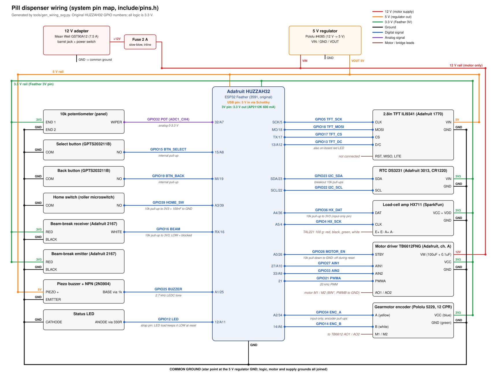

# System wiring, power budget and bring-up

Target: **original** Adafruit HUZZAH32 (product 3591, PlatformIO `featheresp32`).
The single source of truth for pins is [`include/pins.h`](../include/pins.h); the
diagram is generated from the same table by `python3 tools/gen_wiring_svg.py`.
Nothing in this document has been verified on hardware yet. Values marked
**assumed** need checking against the part you actually have.

## (a) Wiring diagram

[`wiring.svg`](wiring.svg): power distribution at the top, the Feather in the
middle and every signal wire labelled `GPIO<n> <NET>`. Rail colours: red 12 V,
orange 5 V, green 3.3 V, black GND.

## (b) Pin table

Every one of the 21 GPIOs on the original HUZZAH32 headers is used. There are
no spare pins. Adding a peripheral means sharing the I2C bus (GPIO23/22) or
giving up the buzzer or the status LED.

| GPIO | Silk | Net | Direction | Connects to | Notes |
| --- | --- | --- | --- | --- | --- |
| 5 | SCK | TFT_SCK | out | TFT CLK | VSPI clock |
| 18 | MO | TFT_MOSI | out | TFT MOSI | |
| 17 | TX | TFT_CS | out | TFT CS | |
| 13 | 13/A12 | TFT_DC | out | TFT D/C | Also drives the on-board red LED, which flickers with SPI traffic. This is harmless. |
| 32 | 32/A7 | POT | analog in | Pot wiper | **ADC1**_CH4, so it works with WiFi on. Pot ends go to 3V and GND. |
| 15 | 15/A8 | BTN_SELECT | in, pull-up | Select button to GND | Strap pin (MTDO). Holding the button at reset only mutes the ROM boot log. |
| 19 | MI | BTN_BACK | in, pull-up | Back button to GND | Not used as SPI MISO: the TFT is write-only (`SPI.begin(5, -1, 18)`). Also the `motor-*` test button. |
| 39 | A3 | HOME_SW | in | Microswitch NO to GND | Input-only with no pull-up: needs an **external 10k to 3V** plus 100 nF to GND. |
| 16 | RX | BEAM | in, pull-up | 2167 receiver (white) | Plus an external 10k to 3V. LOW = blocked. Uses a CHANGE interrupt. |
| 34 | A2 | ENC_A | in | Encoder A (yellow) | Input-only. The encoder board has its own pull-ups. CHANGE interrupt. |
| 14 | 14/A6 | ENC_B | in | Encoder B (white) | CHANGE interrupt |
| 36 | A4 | HX_DAT | in | HX711 DAT | Input-only: needs an **external 10k to 3V** |
| 4 | A5 | HX_SCK | out | HX711 CLK | |
| 23 | SDA | I2C_SDA | i/o | DS3231 SDA | The breakout has 10k pull-ups, so power it from 3V |
| 22 | SCL | I2C_SCL | out | DS3231 SCL | |
| 27 | 27/A10 | AIN1 | out | TB6612 AIN1 | |
| 33 | 33/A9 | AIN2 | out | TB6612 AIN2 | |
| 21 | 21 | PWMA | out (PWM) | TB6612 PWMA | 20 kHz, 10-bit LEDC |
| 26 | A0 | MOTOR_EN | out | TB6612 STBY | **External 10k pull-down** so the driver stays off through reset and boot |
| 25 | A1 | BUZZER | out (PWM) | NPN base via 1k | 2.7 kHz tone |
| 12 | 12/A11 | LED | out | LED anode via 330R, cathode to GND | Strap pin (MTDI). The LED-to-GND load keeps it LOW at reset (3.3 V flash), which is required. |

TB6612 channel B (BIN1, BIN2, PWMB) is tied to GND. The TFT's RST, MISO and
LITE pins are left unconnected. The DS3231 SQW/32K pins are also unconnected.

### Changes from the previous `pins.h` (and why)

| Signal | Old | New | Reason |
| --- | --- | --- | --- |
| MOTOR_ENABLE (STBY / nSLEEP) | 32 | **26** | GPIO32 is the pot in the team TFT sketch, and the pot must be on an ADC1 pin. Moving the pot instead would mean rewiring the panel. GPIO26 has no strapping or boot glitches, and the external pull-down still holds STBY low. |
| LED | 13 (on-board) | **12** (external) | GPIO13 is TFT D/C in the team sketch. An LED to GND on GPIO12 holds the MTDI strap LOW, which is the safe state. |
| BUTTON | 19 | 19 (now `BTN_BACK`) | Unchanged. MISO is not connected, so there is no SPI conflict. `Pins::BUTTON` still names it for the motor test. |
| PWMA | tied to 3.3 V | **21** | Needed for closed-loop speed control. `motor-tb6612` now drives it HIGH. |
| New pins | | POT 32, SELECT 15, HOME 39, TFT 5/18/17/13, I2C 23/22, BUZZER 25 | |

Things kept from the team TFT sketch: pot on GPIO32, TFT CS 17, D/C 13, SCK 5,
MOSI 18 and no MISO. **A board already wired for the old motor test must be
rewired:** move STBY (and its pull-down) from GPIO32 to GPIO26, and connect
PWMA to GPIO21 instead of 3.3 V.

Strap pins: GPIO12 carries only the LED load, which pulls toward GND.
**Never** connect GPIO12 to anything with a pull-up, such as a driver input
with an on-board pull-up. A high level at reset selects 1.8 V flash and the
board will not boot. GPIO15 has a button to GND; the internal pull-up means it
reads HIGH unless the button is held. GPIO0 and GPIO2 are not broken out on
this board.

## (c) Components

The currents below are typical and peak values on the rail that feeds each
part. Sources: the parts' product pages and datasheets, or **assumed** where
noted.

| Component | Role | Supply | Logic level | Typical | Peak |
| --- | --- | --- | --- | --- | --- |
| Adafruit HUZZAH32 (ESP32) | Controller | 5 V into the USB pin via a Schottky diode. On-board AP2112K gives 3.3 V (600 mA). | 3.3 V | 70 mA | 250 mA (allows for radio bursts; the firmware does not enable WiFi) |
| Pololu 5229 gearmotor, 1000:1 HPCB 12 V | Drum drive | 12 V through the TB6612 | n/a | ~0.1 A while indexing (**assumed**) | Stall current **unknown**. Assumed < 1 A at 12 V (HPCB micro metal gearmotors are well under 1 A); 1 A is used as the design ceiling. |
| Gearmotor encoder (12 CPR, two Hall sensors) | Position | 3.3 V | 3.3 V push-pull with pull-ups | 5 mA (**assumed**) | 10 mA |
| Adafruit TB6612FNG breakout | H-bridge, channel A | VM 12 V; VCC 3.3 V | 3.3 V | VCC 1.1 mA | VCC 2 mA. Motor channel rated 1.2 A continuous, 3.2 A peak. |
| Pololu #4085 regulator | 12 V to 5 V | 12 V | n/a | | Rated output current: **check the product page**. This budget needs < 0.45 A. |
| Adafruit 1770 2.8" TFT (ILI9341) | Display | 5 V on VIN (on-board 3.3 V regulator and level shifting) | 3.3 V | 100 mA, mostly backlight (**assumed**) | 120 mA |
| Adafruit 3013 DS3231 + CR1220 | Real-time clock | 3.3 V | 3.3 V I2C | 0.2 mA | 0.6 mA (temperature conversion) |
| SparkFun HX711 + TAL221 100 g | Cup weight | 3.3 V (VCC and VDD) | 3.3 V | 1.5 mA + 3.3 mA bridge (**assumed** 1 k bridge) | 5 mA |
| Adafruit 2167 IR beam-break, 3 mm | Pill counter | 3.3 V | Open collector, 3.3 V pull-up | Emitter 10 mA, receiver 0.5 mA | 11 mA |
| 10k panel pot | Menu scroll | 3.3 V | Analog 0 to 3.3 V | 0.33 mA | 0.33 mA |
| 2 x GPTS203211B momentary | Select / Back | n/a | Switch to GND | 0 | 0.1 mA (internal pull-up) |
| Roller-lever microswitch | Drum home | n/a | Switch to GND | 0 | 0.33 mA (10k pull-up) |
| Piezo buzzer + 2N3904 (optional) | Alerts | 5 V | Driven by a 3.3 V GPIO | 0 | 30 mA (**assumed**; worst case is a magnetic buzzer) |
| Status LED + 330R (optional) | Status | 3.3 V GPIO | | 2 mA average | 4 mA |
| Pull-ups (beam, home, HX DAT) and STBY pull-down | | 3.3 V | | 1 mA | 1.3 mA |

## (d) Power budget

**3.3 V rail.** Source: the Feather's AP2112K, 600 mA max.

| Load | Typical (mA) | Peak (mA) |
| --- | --- | --- |
| ESP32 | 70 | 250 |
| Beam-break (emitter + receiver) | 10.5 | 11 |
| Encoder | 5 | 10 |
| HX711 + load cell | 5 | 5 |
| Status LED | 2 | 4 |
| TB6612 VCC | 1.1 | 2 |
| Pull-ups and pull-downs | 1 | 1.3 |
| Pot | 0.3 | 0.3 |
| DS3231 | 0.2 | 0.6 |
| **Total** | **≈ 95 mA** | **≈ 285 mA** |

The peak load is 48 % of the 600 mA rating, which leaves more than 2x
headroom. The AP2112K dissipates (4.7 - 3.3) V x 0.285 A ≈ 0.4 W at peak and
≈ 0.13 W typical. That is acceptable, but keep the Feather out of enclosed
hot spots.

**5 V rail.** Source: Pololu #4085.

| Load | Typical (mA) | Peak (mA) |
| --- | --- | --- |
| Feather (the 3.3 V rail through a linear regulator: same current) | 95 | 285 |
| TFT, backlight on | 100 | 120 |
| Buzzer | 0 | 30 |
| **Total** | **≈ 195 mA (1.0 W)** | **≈ 435 mA (2.2 W)** |

If the #4085 is rated at 1 A or more (**verify**), peak headroom is at least
2.3x. If it is rated lower than about 0.6 A, choose a larger 5 V regulator.

**12 V rail.** Source: Mean Well GST90A12, 12 V and 7.5 A.

| Load | Typical (A) | Peak (A) |
| --- | --- | --- |
| Gearmotor via TB6612 | 0.10 while indexing, 0 when idle | 1.0 at stall (assumed ceiling) |
| 5 V regulator input: P / (12 V x 0.85), efficiency **assumed** | 0.10 | 0.21 |
| **Total** | **≈ 0.2 A while indexing, ≈ 0.1 A idle** | **≈ 1.2 A (14.5 W)** |

The adapter is rated 7.5 A, more than 6x the worst case. It is far larger than
needed, which is exactly why a fuse is required.

**Fuse.** Fit a **2 A slow-blow** fuse inline on +12 V right after the barrel
jack, before both the TB6612 VM and the regulator. It must sit above the
≈ 1.2 A worst case, below the TB6612's 3.2 A peak, and below the rating of
22 AWG hook-up wire. Without it, a short on a 7.5 A supply will burn wiring
before the adapter's own protection trips. The firmware also cuts drive after
300 ms of stall (`MECH_JAM_STALL_MS`), so stall current flows only briefly. A
0.5 A PTC on the 5 V output is optional.

## (e) Build and bring-up order

Do one step at a time. Record each result in the table at the end of
[component-tests.md](component-tests.md). Only `pio run` builds have been
checked by the coding agent. None of these steps has been performed.

1. **Inspect before powering up.** With nothing powered, check continuity
   with a meter. There must be no short from 12 V, 5 V or 3.3 V to GND. All
   grounds must be common.
2. **Power stage, no loads.** Connect the adapter, fuse, switch and #4085
   regulator only, with the Feather and TB6612 disconnected. **Pass:** 12 V
   rail 11.4 to 12.6 V, 5 V rail 4.85 to 5.15 V, regulator cool to the touch.
3. **Feather from the 5 V rail.** Connect the Schottky diode to the USB pin
   and GND, with USB unplugged. **Pass:** the 3V pin reads 3.25 to 3.35 V.
   Then plug USB in, flash `pio run -e dispenser -t upload` and open
   `pio device monitor`. **Pass:** the banner prints. With no peripherals the
   firmware reports `RTC: NOT FOUND`, then goes to FAULT `JAM` or
   `HOME NOT FOUND`, because the motor is not wired yet. This is expected.
4. **Beam-break** (3.3 V). Wire as in the table, including the 10k pull-up.
   Run `pio run -e beam-break -t upload`. **Pass:** the
   [beam-break criteria](component-tests.md#beam-break-beam-break-115200-baud).
5. **Load cell** (3.3 V). Wire it, including the 10k pull-up on GPIO36. Run
   `load-cell`. **Pass:** the
   [load-cell criteria](component-tests.md#load-cell-load-cell-115200-baud).
6. **TFT, pot, buttons, RTC, home switch, buzzer, LED.** Add one part at a
   time and rerun `pio run -e ui-panel -t upload` after each. The TFT takes
   5 V on VIN. **Pass:** the
   [UI panel criteria](component-tests.md#ui-panel-ui-panel-115200-baud).
   Set the RTC with `T YYYY-MM-DD HH:MM:SS`.
7. **Motor last.** Unplug 12 V first. Wire the TB6612: VM to 12 V with the
   100 µF electrolytic (plus 0.1 µF) at the VM pin, VCC to 3.3 V, STBY to
   GPIO26 with its 10k pull-down, PWMA to 21, AIN1 to 27, AIN2 to 33, and
   channel B inputs to GND. Wire the encoder to 3.3 V, GND, A=34 and B=14.
   Decouple the drum from the motor and power the 12 V. Before any upload,
   measure STBY: it must read < 0.3 V with the board in reset (hold RST).
   Then run `pio run -e motor-tb6612 -t upload`. **Pass:** the
   [motor criteria](component-tests.md#motor-motor-drv8833-or-motor-tb6612-9600-baud).
   The momentary Back button runs the motor only while held, because its
   press and release each toggle the motor. Check that the encoder count
   increases when the output shaft turns in the dispense direction. If it
   does not, swap the motor leads.
8. **Integrated firmware.** Reattach the drum and fit the home switch. Flash
   `dispenser`. Tare and calibrate the scale over serial: `t` with the empty
   cup, then `c 10` with a 10 g mass. Set dose times with `D1 08:00` or from
   the menu. **Pass:** homing ends in IDLE with the clock and next dose shown;
   `d` dispenses one pill and shows "Take your pill"; blocking the drum by
   hand gives a jam reverse-and-retry and then FAULT `JAM`.

## (f) Safety notes

- **One common ground.** Join the adapter, regulator, TB6612, Feather and
  every sensor ground at a star point near the regulator. Return the motor
  current on its own wire from the TB6612 GND to the star point, not through
  the Feather.
- **Decoupling.** Put 100 µF (≥ 25 V electrolytic, per the BOM) plus 0.1 µF
  ceramic directly at TB6612 VM. Put 0.1 µF close to the supply pins of the
  HX711, the beam-break receiver, the encoder and the DS3231. Put 10 µF on the
  5 V rail at the TFT.
- **STBY pull-down.** A 10k from GPIO26 to GND keeps the driver in standby
  during reset, flashing and boot, when the GPIO floats. The firmware sets
  STBY low as the first thing in `setup()`, and again whenever it is not
  moving.
- **Strap pin GPIO12.** Never attach a pull-up load. See section (b).
- **Back-feed.** The Schottky diode on the 5 V-to-USB-pin path stops the
  regulator from back-feeding the PC's USB port (and the reverse) when USB is
  plugged in for programming.
- **Do not power the motor from the Feather.** VM comes only from the fused
  12 V rail. The TB6612 VCC is logic only (3.3 V).
- **Hands clear during homing.** The drum turns by itself at power-up. Keep a
  physical 12 V switch within reach. The serial command `h` re-homes.
- **Pills fallen during homing** are detected and raise FAULT `HOMING DROP`.
  Check the cup before taking anything.
- All signals are 3.3 V. Never feed 5 V into a GPIO: the TFT VIN is 5 V, but
  its logic pins are level-shifted to 3.3 V.

## Wokwi simulation

Wokwi has no DS3231, TB6612, gearmotor with encoder, or IR beam-break part.
[`diagram.json`](../diagram.json) and [`wokwi.toml`](../wokwi.toml) therefore
run the `dispenser-wokwi` build with these substitutions:

| Real part | Wokwi stand-in |
| --- | --- |
| HUZZAH32 | `board-esp32-devkit-c-v4`, same GPIO numbers |
| DS3231 | `wokwi-ds1307`. Same I2C address 0x68 and time registers. RTClib's `lostPower()` reads DS1307 RAM there instead of the oscillator-stop flag. |
| TB6612 + motor + encoder + home switch | LEDs on STBY, AIN1, AIN2 and PWMA. The firmware (`-DDISPENSER_SIM_MOTOR`) runs the core's first-order motor model and a simulated home switch. |
| Beam-break | Push-button "Beam (pill)" on GPIO16. Press it during "Waiting for drop". |
| HX711 + TAL221 | `wokwi-hx711` (5 kg type). It is uncalibrated, so verification is beam-only. |
| Piezo | `wokwi-buzzer` |

To run it locally: `pio run -e dispenser-wokwi`, then start the Wokwi
Simulator from VS Code (the extension needs a free license) or run
`wokwi-cli`. **The simulation has not been run:** wokwi.com is blocked from
the machine that wrote this.

## Open assumptions

- The motor stall current is unknown; 1 A is used as the ceiling. Measure it
  at 12 V with a current-limited bench supply before finalising the fuse.
- The ~35 rpm no-load speed at 12 V is only a feed-forward guess. The
  closed loop corrects for it. If the drum must turn faster than about 30 rpm
  under load, the PWM will saturate.
- The #4085 regulator's current rating, the TFT backlight current, the
  encoder current and the load-cell bridge resistance are unverified.
- The TB6612 breakout is assumed to have no on-board pull-up on STBY; the
  external pull-down depends on that. Measure STBY at reset (bring-up
  step 7).
- Beam-break counting merges block events less than 300 µs apart. Two pills
  falling touching each other can count as one. The load-cell delta then
  shows about 2x the pill mass, but the firmware only checks a minimum mass,
  because the mechanism contract gives no maximum.
- The RTC is set to local time, with no daylight-saving handling.
