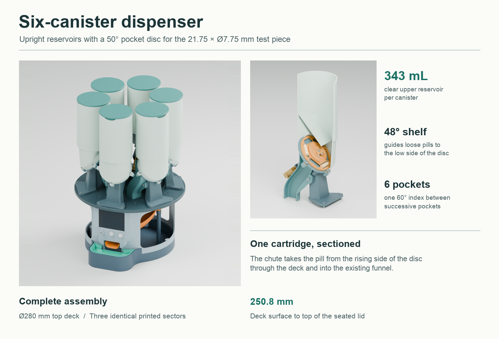

# Two-Feather pill dispenser prototype

This snapshot pairs the latest integrated one-motor bench firmware and wiring with the November 26 six-cartridge mechanical design for a 21.75 × Ø7.75 mm cylindrical test piece.

## Arduino IDE

| Board | Open this sketch | Role |
| --- | --- | --- |
| Original Adafruit HUZZAH32, micro-USB | [Display_HUZZAH32.ino](firmware/Display_HUZZAH32/Display_HUZZAH32.ino) | Display, controls, schedule, RTC, load cell and communication with the motor board |
| Adafruit Feather ESP32 V2, USB-C | [Motor_Feather_V2.ino](firmware/Motor_Feather_V2/Motor_Feather_V2.ino) | Motor driver control, encoder feedback and bench motion commands |

Keep each sketch's source tabs and headers together in its named folder. The bench build used the Espressif ESP32 Arduino core 3.3.11. The display sketch used Adafruit GFX 1.13.0, Adafruit ILI9341 1.7.0, Adafruit BusIO 1.17.4 and RTClib 2.1.4. Both serial monitors use 115200 baud.

**Wheel configuration.** The uploaded firmware snapshot enables canister 1 and sets three pockets per wheel. Its canister 1 bench `STEP` command advances 60°. The new disc has six pockets, also spaced 60° apart. Set the pocket count for each installed wheel and verify direction, index travel and drop behavior with inert pieces before enabling automatic dispensing. [Motor settings](firmware/Motor_Feather_V2/MotorSettings.h)

## Bench wiring

The November 24 drawing shows the two USB-powered Feathers, one TB6612 motor channel and its encoder, the TFT, buttons, knob, DS3231 clock and HX711 load cell.

[Zoomable breadboard drawing](wiring/Integrated_Breadboards.svg) · [PNG preview](wiring/Integrated_Breadboards.png) · [Board A wire checklist (download and open locally)](wiring/Board_A_Wire_Checklist.html)

## Mechanical assembly

[Full assembly STEP](cad/Six_Canister_Dispenser.step) · [Single cartridge STEP](cad/Single_Canister.step) · [Print-ready STLs](cad/Print_Parts.zip) · [Print and assembly guide](cad/Assembly_and_Print_Guide.pdf)

To rebuild the exports, extract the CAD source and its exact V7 reference input into the same directory. Follow the source README. Each STEP download above can also be opened directly in CAD. [Editable CAD source](cad/Editable_CAD_Source.zip) · [Reference model for rebuilding](cad/Editable_CAD_Reference.zip)
